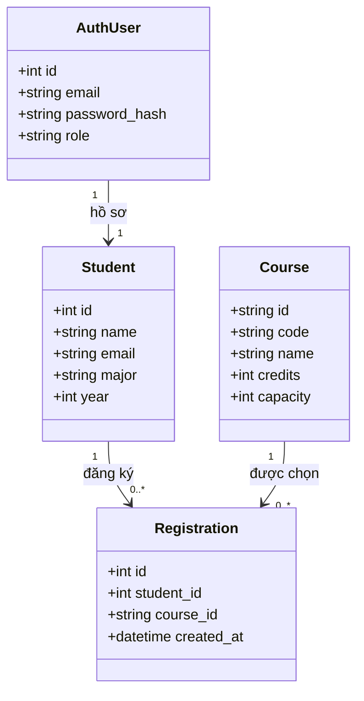
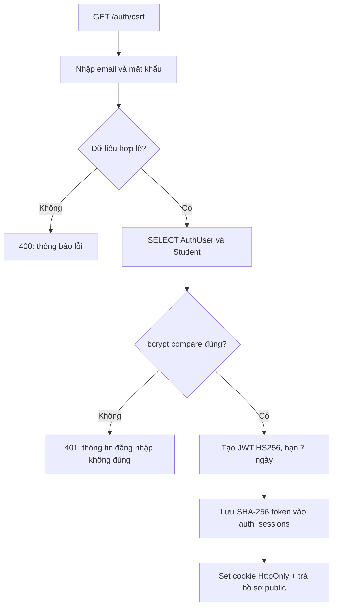
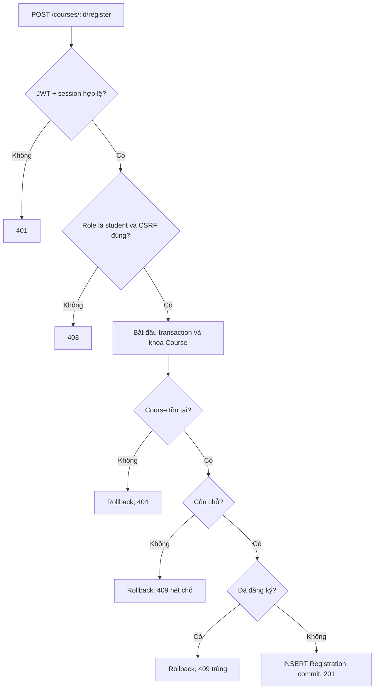

# Báo cáo đồ án: UniManage

**Đề tài:** Hệ thống Quản lý Sinh viên và Đăng ký Khóa học

**Nhóm:** 2 sinh viên

**Công nghệ:** Node.js 22, Express 5, React 18, React-Bootstrap, SQLite/MySQL

**Giấy phép:** MIT

> Điền họ tên, mã sinh viên, lớp và giảng viên hướng dẫn vào trang bìa bản nộp. Tài khoản giảng viên chưa có luồng tự đăng ký; chỉ tài khoản sinh viên được tự tạo, còn admin được cấp qua cấu hình triển khai.

## 1. User Stories

Mỗi phân hệ chiếm 25% tổng số 12 stories, tương ứng 3 stories/phân hệ.

| ID | Phân hệ | User story | Tiêu chí chấp nhận chính |
|---|---|---|---|
| US01 | Xác thực & tài khoản | Là sinh viên, tôi muốn tạo tài khoản bằng email và hồ sơ học tập để sử dụng cổng học tập. | Email hợp lệ, email trùng bị từ chối, mật khẩu không được trả về client. |
| US02 | Xác thực & tài khoản | Là người dùng, tôi muốn đăng nhập và đăng xuất an toàn để bảo vệ phiên sử dụng của mình. | Cookie phiên `httpOnly`, session hết hạn sau 7 ngày, logout thu hồi session. |
| US03 | Xác thực & tài khoản | Là quản trị viên, tôi muốn quyền được xác định theo vai trò để bảo vệ chức năng quản trị. | Sinh viên không truy cập API admin; role không được chọn lúc đăng ký. |
| US04 | Tra cứu | Là sinh viên, tôi muốn tìm học phần theo tên/mã và lọc theo khoa để tìm môn phù hợp. | Tìm kiếm không phân biệt một phần chuỗi; chỉ trả dữ liệu học phần công khai. |
| US05 | Tra cứu | Là sinh viên, tôi muốn xem mô tả, giảng viên, tín chỉ và số chỗ còn lại để quyết định đăng ký. | Học phần không tồn tại trả 404; số chỗ lấy từ CSDL. |
| US06 | Tra cứu | Là quản trị viên, tôi muốn tìm sinh viên theo tên, email hoặc ngành để hỗ trợ công tác đào tạo. | Chỉ admin được đọc danh sách; kết quả không chứa mật khẩu/hash. |
| US07 | Đăng ký & lịch học | Là sinh viên, tôi muốn đăng ký học phần còn chỗ để xây dựng kế hoạch học tập. | Cần đăng nhập; từ chối học phần hết chỗ hoặc đăng ký trùng. |
| US08 | Đăng ký & lịch học | Là sinh viên, tôi muốn xem danh sách học phần đã đăng ký để theo dõi lịch học cá nhân. | Chỉ trả đăng ký của tài khoản hiện tại. |
| US09 | Đăng ký & lịch học | Là sinh viên, tôi muốn hủy đăng ký để điều chỉnh kế hoạch học tập. | Hủy thành công trả 204; đăng ký không tồn tại trả 404. |
| US10 | Quản trị | Là admin, tôi muốn tạo hồ sơ sinh viên để cập nhật danh sách đào tạo. | Validate trường bắt buộc; email trùng trả 409. |
| US11 | Quản trị | Là admin, tôi muốn cập nhật hồ sơ sinh viên để sửa dữ liệu sai hoặc lỗi thời. | Dữ liệu hợp lệ trả hồ sơ mới; ID không tồn tại trả 404. |
| US12 | Quản trị | Là admin, tôi muốn xóa hồ sơ sinh viên để loại bỏ dữ liệu không còn hiệu lực. | Xóa thành công trả 204; khóa ngoại xóa session/tài khoản/đăng ký liên quan theo cascade. |

## 2. Phân tích hệ thống

### 2a. Đối tượng và quan hệ

- **User/AuthUser:** thông tin xác thực, email, password hash, role (`student` hoặc `admin`) và các session. Mỗi `AuthUser` liên kết đúng một hồ sơ `Student`.
- **Student:** hồ sơ đào tạo gồm tên, email, ngành, năm học. Đây là dữ liệu hồ sơ, tách khỏi thông tin xác thực.
- **Course:** mã, tên, tín chỉ, giảng viên, khoa, mô tả và sức chứa.
- **Enrollment/Registration:** bảng nối giữa `Student` và `Course`, có thời điểm đăng ký và unique key `(student_id, course_id)`.
- Quan hệ logic **User 1-N Enrollment** được ánh xạ qua `AuthUser.student_id -> Student.id`; quan hệ **Course 1-N Enrollment** nối trực tiếp qua `course_id`.



### 2b. Thuật toán hai luồng chính

**Đăng nhập bảo mật:** validate đầu vào → tìm AuthUser theo email → bcrypt compare (tài khoản cũ dùng scrypt được xác minh rồi nâng cấp bcrypt) → tạo JWT HS256 hạn 7 ngày → lưu SHA-256 của JWT vào `auth_sessions` → trả cookie HttpOnly và hồ sơ public. `/auth/me` xác minh chữ ký JWT, hạn dùng và session còn tồn tại trong DB; logout xóa session nên token bị thu hồi tức thì.



**Đăng ký học phần:** xác minh session/role/CSRF → mở transaction → khóa dòng học phần (MySQL `FOR UPDATE`, SQLite `BEGIN IMMEDIATE`) → kiểm tra tồn tại và sức chứa → insert registration → unique constraint ngăn đăng ký trùng → commit. Mọi lỗi rollback.



## 3. Wireframe, luồng xử lý và kiến trúc

### 3a. Wireframe landing page

```text
┌──────────────────────────────────────────────────────────────┐
│ HEADER: UniManage | Trang chủ | Học phần | Đăng nhập         │
├──────────────────────────────────────────────────────────────┤
│ HERO BANNER                                                  │
│ Quản lý học tập dễ dàng, mọi lúc mọi nơi                     │
│ [Tên hoặc mã học phần____________] [Khoa v] [Tìm kiếm]       │
├──────────────────────────────────────────────────────────────┤
│ LỐI TẮT VAI TRÒ / HƯỚNG DẪN                                 │
├──────────────────────────────────────────────────────────────┤
│ HỌC PHẦN NỔI BẬT  [Tất cả] [CNTT] [Kinh tế] ...             │
│ [Course card]       [Course card]       [Course card]         │
├──────────────────────────────────────────────────────────────┤
│ THỐNG KÊ / CÁCH SỬ DỤNG / THÔNG BÁO                         │
├──────────────────────────────────────────────────────────────┤
│ FAQ (Accordion)                                              │
├──────────────────────────────────────────────────────────────┤
│ FOOTER: liên hệ, điều khoản, bản quyền                       │
└──────────────────────────────────────────────────────────────┘
```

Các thành phần đang có: `Header`, `Hero`, `SearchBox`, `CourseList`, `FAQ`, `Footer`; trang landing còn có thống kê, hướng dẫn, thông báo và lối tắt vai trò. SearchBox chỉ gửi `search` và `faculty` tới API. Tra cứu sinh viên là chức năng riêng được giới hạn admin, không công khai dữ liệu sinh viên.

**Mục tiêu ≤4 tương tác:** với sinh viên đã đăng nhập, nhập từ khóa (1) → gửi tìm kiếm (2) → mở học phần (3) → bấm đăng ký (4). Nếu đã thấy học phần ngay trên landing thì mở chi tiết rồi đăng ký, chỉ 2 tương tác. Đăng nhập là điều kiện bảo mật trước đó, không tính là một phần luồng đăng ký đã xác thực.

### 3b. Luồng dữ liệu

```text
React page/component
  -> Axios service (/api, withCredentials + X-CSRF-Token)
  -> Express route (auth/role/CSRF middleware)
  -> Controller (validate, map status/error)
  -> Model (prepared/parameterized SQL)
  -> SQLite hoặc MySQL
  <- Model result
  <- Controller JSON + HTTP status
  <- React cập nhật trạng thái UI
```

### 3c. Phân lớp và dữ liệu

- `routes/`: endpoint, thứ tự middleware, xác thực/phân quyền.
- `controllers/`: kiểm tra dữ liệu, gọi model, ánh xạ kết quả sang HTTP.
- `models/`: truy vấn tham số hóa và ánh xạ record sang dữ liệu ứng dụng.
- `database/`: schema MySQL, SQLite local store, seed, khởi tạo.
- `middleware/`: session/JWT, CSRF, role.
- `react-node-app/src/`: pages, components, services, styles.
- `LICENSE`: MIT, thông báo bản quyền ở thư mục gốc.

Hệ thống hiện dùng **Data Mapper/DAO viết thủ công trong các model**, không cài Sequelize/Prisma; cùng một nghiệp vụ có nhánh SQLite/MySQL để không phụ thuộc driver ORM. Đây là lựa chọn phù hợp với hai backend CSDL hiện tại, nhưng cần ghi đúng trong báo cáo, không gọi là ORM bên thứ ba.

### 3d. Bảo mật và dữ liệu frontend

- JWT HS256 được ký bằng `SESSION_SECRET`, hạn 7 ngày, chứa trong cookie `httpOnly`, `SameSite=Lax`; ở production cookie bật `Secure`.
- DB chỉ giữ SHA-256 token hash cùng expiry/user ID, hỗ trợ thu hồi phiên server-side. Không lưu JWT vào `localStorage`.
- Password hash dùng bcrypt cost 12; mật khẩu cũ dạng scrypt được migrate khi đăng nhập hợp lệ.
- CSRF double-submit: cookie `unimanage_csrf` + header `X-CSRF-Token`, so sánh constant-time cho mọi mutation.
- CORS dùng allowlist `CORS_ORIGINS`, không bật wildcard khi credentials; cùng origin không cần mở CORS.
- Helmet bật security headers/CSP mặc định; React render text escaped, không đưa dữ liệu nhạy cảm vào HTML tùy biến.
- API trả `publicUser` whitelist; không trả `password_hash`, salt, JWT hoặc session record.
- Rate limit login: 10 lần/15 phút; đăng ký: 5 lần/giờ. Role admin không nhận từ payload đăng ký.

## 4. API và xử lý lỗi

Tất cả mutation cần CSRF token trước. Cookie được gửi tự động với `withCredentials: true`. Mẫu lỗi: `{"message":"..."}`. Danh sách dưới đây thể hiện response thành công và status lỗi nghiệp vụ chính.

| Method | Endpoint | Quyền | Body/query | Thành công | Status lỗi chính |
|---|---|---|---|---|---|
| GET | `/api/health` | Public | Không | `{status:"ok",database:"local-sqlite"}` hoặc `connected` | 503 |
| GET | `/api/auth/csrf` | Public | Không | `{csrfToken}` + cookie CSRF | 500 |
| POST | `/api/auth/register` | Public + CSRF | `{name,email,major,year,password}` | 201 `{user}` | 400, 409, 403, 429 |
| POST | `/api/auth/login` | Public + CSRF | `{email,password}` | 200 `{user}` + cookie session | 400, 401, 403, 429 |
| GET | `/api/auth/me` | Public | Cookie session | 200 `{user}` hoặc `{user:null}` | 500 |
| POST | `/api/auth/logout` | Session + CSRF | Không | 204, xóa cookie/session | 403, 500 |
| GET | `/api/courses` | Public | `search`, `faculty` | 200 `Course[]` có enrolled/remaining | 500 |
| GET | `/api/courses/:id` | Public | Không | 200 `Course` | 404 |
| POST | `/api/courses` | Admin + CSRF | `{id,name,code,credits,lecturer,capacity,faculty,description}` | 201 `Course` | 400, 403, 409 |
| PUT | `/api/courses/:id` | Admin + CSRF | Các trường Course trừ `id` | 200 `Course` | 400, 403, 404, 409 nếu trùng mã hoặc giảm sức chứa dưới đăng ký hiện tại |
| DELETE | `/api/courses/:id` | Admin + CSRF | Không | 204 | 403, 404, 409 nếu còn enrollment |
| GET | `/api/courses/mine` | Student | Cookie session | 200 `Course[]` đã đăng ký | 401, 403 |
| POST | `/api/courses/:id/register` | Student + CSRF | Không | 201 `{message}` | 401, 403, 404, 409 |
| DELETE | `/api/courses/:id/register` | Student + CSRF | Không | 204 | 401, 403, 404 |
| GET | `/api/students` | Admin | `search` | 200 `Student[]` | 401, 403 |
| GET | `/api/students/:id` | Admin | Không | 200 `Student` | 401, 403, 404 |
| POST | `/api/students` | Admin + CSRF | `{name,email,major,year}` | 201 `Student` | 400, 401, 403, 409 |
| PUT | `/api/students/:id` | Admin + CSRF | `{name,email,major,year}` | 200 `Student` | 400, 403, 404, 409 |
| DELETE | `/api/students/:id` | Admin + CSRF | Không | 204 | 403, 404 |

**Ví dụ response:**

```json
{
  "user": {
    "id": 12,
    "name": "Nguyen Van A",
    "email": "student@example.edu",
    "major": "Cong nghe thong tin",
    "year": 2,
    "role": "student"
  }
}
```

Controller async được Express 5 chuyển lỗi tới error middleware cuối ứng dụng; lỗi nội bộ trả thông báo chung 500, chi tiết chỉ ghi log server. Lỗi nghiệp vụ dự kiến được ánh xạ cụ thể 400/401/403/404/409.

## 5. Frontend và usability

Các route hiện có: `/` landing, `/search`, `/courses/:id`, `/login`, `/register`, `/dashboard`, `/admin/students`. `ProtectedRoute` bảo vệ dashboard; admin page yêu cầu role admin. Các page dùng `react-bootstrap` (`Container`, `Card`, `Form`, `Button`, `Table`, `Alert`, `Accordion`) và chung Header/Footer.

Luồng đăng ký tiêu chuẩn bắt đầu ở danh sách khóa học hoặc trang tìm kiếm. Trên course detail, trạng thái đăng ký/hủy, chỗ còn lại, lỗi hết chỗ và yêu cầu đăng nhập đều hiển thị ngay cạnh hành động. Phần nhập kỳ học đã được bỏ khỏi SearchBox vì schema hiện chưa có kỳ học; tránh filter giả không tác dụng.

## 6. CSDL, mapping và SQL

Hai lựa chọn cấu hình: SQLite mặc định tại `.data/unimanage.sqlite`; MySQL khi đủ `DB_HOST`, `DB_PORT`, `DB_NAME`, `DB_USER`, `DB_PASSWORD`. Foreign key có cascade từ student/course sang registrations và từ student sang auth user/session. Các model dùng prepared statement hoặc placeholder `?`, tránh nối dữ liệu người dùng vào SQL.

| Nghiệp vụ | Truy vấn đại diện |
|---|---|
| Đăng nhập | `SELECT users.id, users.password_hash, users.password_salt, users.role, students.name, students.email, students.major, students.year FROM auth_users users JOIN students ON students.id = users.student_id WHERE users.email = ?` |
| Tạo student | `INSERT INTO students (name,email,major,year) VALUES (?,?,?,?)` |
| Sửa student | `UPDATE students SET name=?, email=?, major=?, year=? WHERE id=?` |
| Xóa student | `DELETE FROM students WHERE id=?` (FK cascade xóa auth/session/registration) |
| Tra cứu course | `SELECT ... COUNT(course_registrations.id) AS enrolled, courses.capacity - COUNT(...) AS remaining FROM courses LEFT JOIN course_registrations ... WHERE name/code/faculty LIKE ? GROUP BY courses.id` |
| Tạo course | `INSERT INTO courses (id,name,code,credits,lecturer,capacity,faculty,description) VALUES (?,?,?,?,?,?,?,?)` |
| Sửa course | `UPDATE courses SET name=?, code=?, credits=?, lecturer=?, capacity=?, faculty=?, description=? WHERE id=?` |
| Xóa course | `DELETE FROM courses WHERE id=?` sau khi xác nhận không còn đăng ký |
| Đăng ký | `INSERT INTO course_registrations (student_id,course_id) VALUES (?,?)` trong transaction; unique key ngăn trùng |
| Hủy đăng ký | `DELETE FROM course_registrations WHERE course_id=? AND student_id=(SELECT student_id FROM auth_users WHERE id=?)` |

`init.js` nạp `schema.sql` và seed course cho MySQL; `localStore.js` khởi tạo schema SQLite; `dbconnection.js` chọn MySQL khi cấu hình đầy đủ. Model trả record đã ánh xạ cho controller; controller không biết chi tiết driver ngoài mã lỗi nghiệp vụ.

## 7. Kiểm thử và kiểm định

### 7a. Bắt lỗi

Validation ở controller; các lỗi duplicate/full/not-found được map sang HTTP; transaction rollback khi đăng ký lỗi; Express error middleware trả 500 tổng quát. SQLite/MySQL dùng placeholder; giới hạn JSON 32 KB. Session cleanup chạy theo giờ.

### 7b. Unit và integration test

Chạy `npm test`. Bộ `node:test` nằm tại `react-node-app/test/api.test.cjs`, dùng server Express thật qua HTTP và SQLite `:memory:` độc lập, không sửa dữ liệu `.data`.

- 12 test `US01`–`US12`: đăng ký, login/logout, role, tìm khóa, xem chi tiết, admin tìm sinh viên, đăng ký học phần, xem lịch, hủy, tạo/sửa/xóa hồ sơ.
- 3 integration bổ sung: JWT giả mạo, migrate scrypt → bcrypt, CRUD khóa học + role/xóa khi đang có đăng ký.
- 3 unit test validator: credentials, student, course.
- Tổng cộng: **19 test tự động**.

### 7c–7d. Ma trận kịch bản API

| Kịch bản | Kỳ vọng | Đã chạy |
|---|---|---|
| Đăng ký hợp lệ, login và `/me` | 201/200, session hoạt động | Có |
| Mật khẩu/email sai định dạng | 400; không ghi dữ liệu | Có (validator) |
| Email trùng | 409 | API có xử lý; chưa có ca riêng |
| Guest gọi API riêng tư | 401 | Có |
| Sinh viên gọi API admin | 403 | Có |
| Tìm khóa/detail ID sai | 200/404 | Có |
| Đăng ký khi còn chỗ / đăng ký trùng / hết chỗ | 201/409 với thông báo phân biệt | Có |
| Admin giảm sức chứa dưới số sinh viên đã đăng ký | 409; dữ liệu giữ nguyên | Có |
| Đăng ký khi hết chỗ | 409 | Có |
| Hủy đăng ký thành công | 204 và lịch cập nhật | Có |
| JWT sai chữ ký / session đã logout | 401 hoặc user null | Có |
| Tạo/sửa/xóa hồ sơ admin | 201/200/204 | Có |
| Lỗi kết nối CSDL hoặc exception bất ngờ | 503/500 chung | Có middleware; chưa giả lập DB down |

### 7e. Checklist UI/UX responsive

Build frontend đã chạy thành công. Cần xác nhận thủ công trên trình duyệt trước khi nộp vì môi trường hiện chưa chạy bộ browser automation:

| Viewport | Kiểm tra |
|---|---|
| Desktop 1440×900 | Header, hero search, course grid 4 cột, footer; không tràn ngang |
| Tablet 768×1024 | Search xếp hàng hợp lý; cards 2 cột; FAQ thao tác được |
| Mobile 390×844 | Search/control xếp dọc; CTA không tràn; course card một cột |
| Mobile 320×700 | Không có overflow ngang; button và label không chồng lấn |
| Keyboard/accessibility | Tab order, label input, focus, accordion; lỗi/thành công đọc được |
| Luồng student | Từ landing/search đến đăng ký ≤4 tương tác khi đã login; hết chỗ hiển thị lỗi rõ |
| Luồng admin | Đăng nhập admin, tìm/tạo/sửa/xóa hồ sơ; student bị từ chối `/admin/students` |

## Chạy dự án

```bash
npm ci
cp .env.example .env
# Điền SESSION_SECRET dài tối thiểu 32 ký tự và thông tin ADMIN_EMAIL/ADMIN_PASSWORD
npm run dev:server
# Terminal khác:
npm run dev
```

Sinh secret production bằng `openssl rand -hex 32`. Khi frontend chạy origin khác, đặt `CORS_ORIGINS` thành danh sách origin tin cậy, phân tách bằng dấu phẩy. Không commit `.env`. Báo cáo này phản ánh implementation tại thời điểm nộp; hãy điền thông tin thành viên nhóm và chạy checklist UI thật trên thiết bị mục tiêu.
