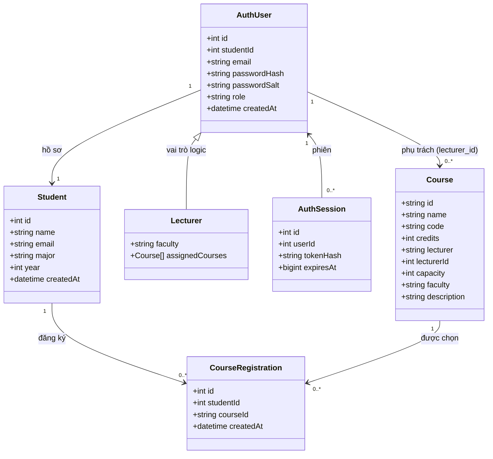
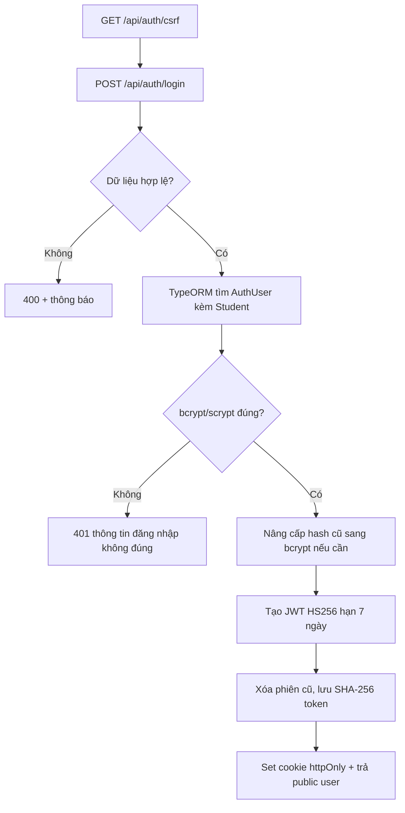
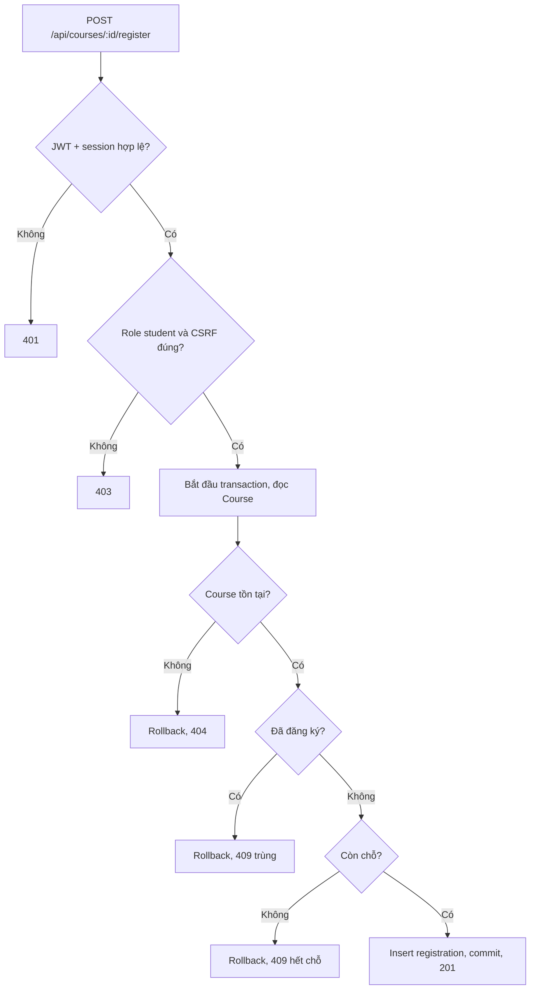
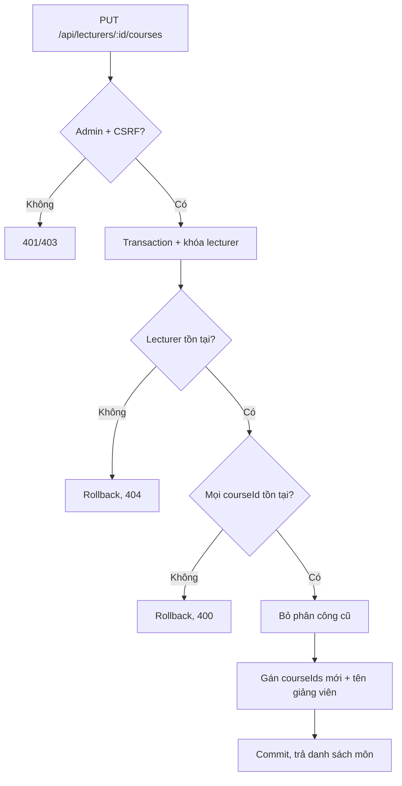

# Báo cáo đồ án: UniManage

**Đề tài:** Hệ thống Quản lý Sinh viên và Đăng ký Học phần

**Nhóm:** 2 sinh viên

**Công nghệ:** NestJS 11, TypeORM 0.3, React 18, React-Bootstrap, Swagger/OpenAPI, SQLite (sql.js) hoặc MySQL

**Giấy phép:** MIT (`LICENSE` ở thư mục gốc)

> **Thông tin bản nộp:** điền họ tên, mã sinh viên, lớp, giảng viên hướng dẫn và link demo/GitHub vào mục 8 và mục 10. Các chỗ `[...]` là placeholder, không phải dữ liệu thật.

## Đối chiếu nhanh với yêu cầu

| Yêu cầu | Đáp ứng trong mã nguồn |
|---|---|
| Backend dùng NestJS | `backend/src/`, `backend/src/app.module.ts`, module hóa `auth`, `students`, `lecturers`, `courses`, `database` |
| Có ORM, không viết SQL thủ công cho CRUD | TypeORM Data Mapper: `backend/src/database/entities.ts`, repository/transaction trong các service |
| Tài liệu API chuyên nghiệp | Swagger UI `/api/docs`, OpenAPI JSON `/api/docs-json` |
| Frontend React + thư viện UI | `react-node-app/src/`, React 18 + React-Bootstrap, Vite |
| Giấy phép | MIT tại `LICENSE`, ghi chú bản quyền trong `main.jsx` |
| Kiểm thử | 25 test tự động (`npm test`) + checklist UI thủ công mục 7 |
| Phân tích pháp lý/đạo đức | Mục 9 |
| Lịch sử Git, phân công | Mục 10 (điền link và tên thật trước khi nộp) |

## 1. User Stories

Nhóm có **2 sinh viên**, vượt mức tối thiểu 12 user stories: hệ thống đặc tả **17 user stories** (US01–US17). Mỗi story đều có tiêu chí chấp nhận kiểm thử được.

### 1a. Phân bổ theo phân hệ

| Phân hệ | User stories | Số lượng | Tỷ lệ |
|---|---|---:|---:|
| Xác thực và tài khoản | US01–US03 | 3 | 17,6% |
| Tra cứu học phần/sinh viên | US04–US06 | 3 | 17,6% |
| Đăng ký và lịch học | US07–US09 | 3 | 17,6% |
| Quản trị sinh viên | US10–US12, US17 | 4 | 23,5% |
| Quản trị giảng viên | US13–US16 | 4 | 23,5% |
| **Tổng** |  | **17** | **100%** |

### 1b. Danh sách user stories

| ID | Phân hệ | User story | Tiêu chí chấp nhận chính |
|---|---|---|---|
| US01 | Xác thực | Là sinh viên, tôi muốn tạo tài khoản bằng email và hồ sơ học tập để sử dụng cổng học tập. | Email hợp lệ; email trùng trả 409; role luôn là `student`; response không có hash/salt. |
| US02 | Xác thực | Là người dùng, tôi muốn đăng nhập/đăng xuất an toàn để bảo vệ phiên. | Cookie `httpOnly`; session lưu hash trong DB; logout thu hồi session; `/auth/me` trả `user: null` sau logout. |
| US03 | Xác thực | Là quản trị viên, tôi muốn quyền được kiểm tra theo vai trò để bảo vệ chức năng quản trị. | Guest nhận 401; sinh viên gọi API admin nhận 403; role không lấy từ payload đăng ký. |
| US04 | Tra cứu | Là sinh viên, tôi muốn tìm học phần theo tên/mã và lọc theo khoa để chọn môn phù hợp. | `search` so khớp một phần trên tên/mã/khoa; `faculty` lọc chính xác; chỉ trả dữ liệu công khai. |
| US05 | Tra cứu | Là sinh viên, tôi muốn xem mô tả, giảng viên, tín chỉ và số chỗ còn lại để quyết định đăng ký. | ID không tồn tại trả 404; `enrolled`/`remaining` tính từ CSDL. |
| US06 | Tra cứu | Là quản trị viên, tôi muốn tìm sinh viên theo tên, email hoặc ngành để hỗ trợ đào tạo. | Chỉ admin; không trả tài khoản giảng viên/admin trong danh sách sinh viên. |
| US07 | Đăng ký | Là sinh viên, tôi muốn đăng ký học phần còn chỗ để xây dựng kế hoạch học tập. | Cần đăng nhập + CSRF; hết chỗ 409; đăng ký trùng 409; thành công 201. |
| US08 | Đăng ký | Là sinh viên, tôi muốn xem danh sách học phần đã đăng ký để theo dõi lịch học. | Chỉ trả đăng ký của tài khoản hiện tại, sắp xếp mới nhất trước. |
| US09 | Đăng ký | Là sinh viên, tôi muốn hủy đăng ký để điều chỉnh kế hoạch. | Hủy thành công 204; chưa đăng ký trả 404; lịch học cập nhật ngay. |
| US10 | Quản trị sinh viên | Là admin, tôi muốn tạo hồ sơ sinh viên để cập nhật danh sách đào tạo. | Validate tên/email/ngành/năm 1–6; email trùng 409; tạo thành công 201. |
| US11 | Quản trị sinh viên | Là admin, tôi muốn cập nhật hồ sơ sinh viên để sửa dữ liệu sai. | Cập nhật thành công 200; ID không tồn tại 404; email trùng 409; rollback khi lỗi. |
| US12 | Quản trị sinh viên | Là admin, tôi muốn xóa hồ sơ sinh viên để loại bỏ dữ liệu không còn hiệu lực. | Xóa 204; cascade xóa `auth_users`, `auth_sessions`, `course_registrations`; ID sai 404. |
| US13 | Quản trị giảng viên | Là admin, tôi muốn tạo và cập nhật tài khoản giảng viên để cấp quyền giảng dạy. | Tạo 201 với role `lecturer`; mật khẩu bcrypt; sửa không bắt buộc đổi mật khẩu; email trùng 409. |
| US14 | Quản trị giảng viên | Là giảng viên, tôi muốn đăng nhập và xem học phần được phân công. | `GET /lecturers/me/courses` chỉ trả môn của chính mình; sinh viên bị 403. |
| US15 | Quản trị giảng viên | Là admin, tôi muốn phân công học phần cho giảng viên để tổ chức giảng dạy. | Danh sách ID hợp lệ; phân công lại thay thế danh sách cũ; ID môn sai trả 400 và rollback. |
| US16 | Quản trị giảng viên | Là admin, tôi muốn xóa tài khoản giảng viên để thu hồi quyền truy cập. | Xóa 204; thu hồi session; bỏ `lecturer_id` khỏi học phần nhưng giữ tên hiển thị lịch sử. |
| US17 | Quản trị sinh viên | Là admin, tôi muốn sửa hồ sơ và email đăng nhập của sinh viên trong một thao tác. | Cập nhật đồng thời `students.email` và `auth_users.email` trong transaction; đăng nhập bằng email mới. |

### 1c. Phân công thành viên (điền trước khi nộp)

| Thành viên | Họ tên – MSSV – Lớp | Tỷ lệ | Phần việc chính |
|---|---|---:|---|
| Sinh viên 1 | [Họ tên] – [MSSV] – [Lớp] | 50% | NestJS: auth, courses, cấu hình TypeORM, bảo mật, integration test; tích hợp frontend |
| Sinh viên 2 | [Họ tên] – [MSSV] – [Lớp] | 50% | NestJS: students, lecturers; React admin pages, dashboard; báo cáo, kiểm thử, tài liệu API |

> Điều chỉnh tỷ lệ theo đóng góp thực tế. Không giữ nguyên placeholder khi nộp.

## 2. Phân tích hệ thống

### 2a. Thực thể và quan hệ

Hệ thống dùng **một bảng tài khoản** (`auth_users`) với cột `role` nhận `student`, `lecturer`, `admin`; hồ sơ hiển thị nằm ở `students` theo quan hệ 1–1. Cách này tránh lặp thông tin đăng nhập và cho phép giảng viên dùng chung hồ sơ tên/email/khoa.

- **Student:** `id`, `name`, `email` (unique), `major`, `year` (1–6), `created_at`. Là hồ sơ đào tạo, không chứa mật khẩu.
- **AuthUser:** `id`, `student_id` (unique, FK), `email` (unique), `password_hash`, `password_salt` (giữ cho tài khoản scrypt cũ), `role`, `created_at`. Mỗi tài khoản gắn đúng một hồ sơ.
- **AuthSession:** `id`, `user_id` (FK), `token_hash` (unique), `expires_at` (BIGINT mili-giây), `created_at`. Chỉ lưu hash của JWT, không lưu token thô.
- **Course:** `id` (text), `name`, `code` (unique), `credits`, `lecturer` (tên hiển thị), `lecturer_id` (liên kết logic tới `auth_users` role giảng viên), `capacity`, `faculty`, `description`, `created_at`.
- **CourseRegistration:** `id`, `student_id` (FK), `course_id` (FK), `created_at`, unique `(student_id, course_id)`.
- **Lecturer:** là *vai trò logic* của `AuthUser` + `Student` (khoa/bộ môn ánh xạ từ `major`), không có bảng riêng; các học phần phụ trách xác định qua `courses.lecturer_id`.

### 2b. Biểu đồ lớp



Ghi chú: `Lecturer` chỉ là góc nhìn kế thừa logic của tài khoản; CSDL không tạo bảng riêng để tránh trùng lặp dữ liệu.

### 2c. Thuật toán và luồng xử lý

**Đăng nhập bảo mật:** validate email/mật khẩu → tìm `AuthUser` kèm `Student` → so sánh bcrypt; nếu hash cũ dạng scrypt thì xác minh rồi nâng cấp bcrypt cost 12 → tạo JWT HS256 hạn 7 ngày → xóa phiên cũ của tài khoản → lưu SHA-256 của JWT vào `auth_sessions` → trả cookie `httpOnly` + hồ sơ public. Mỗi tài khoản có một phiên hoạt động tại một thời điểm. `/auth/me` kiểm tra chữ ký, `exp`, session hash còn tồn tại và khớp `sub`; logout xóa session nên token bị thu hồi ngay.



**Đăng ký học phần:** guard xác thực cookie JWT → `RolesGuard` yêu cầu `student` → CSRF double-submit → mở transaction TypeORM → đọc user, khóa học phần (MySQL `pessimistic_write`) → kiểm tra tồn tại, đăng ký trùng, sức chứa → insert `course_registrations` → commit. SQLite dùng transaction tuần tự; unique `(student_id, course_id)` là chốt chặn cuối cùng. Mọi lỗi rollback.



**Phân công giảng viên (admin):** mở transaction → khóa tài khoản giảng viên → đếm số học phần khớp danh sách ID; nếu không khớp trả 400 và rollback → bỏ phân công cũ (`lecturer_id = NULL`) → gán danh sách mới và cập nhật tên hiển thị → commit → trả danh sách học phần đã phân công.



**Sửa hồ sơ sinh viên (admin):** validate toàn bộ trường → transaction → cập nhật `students` → cập nhật email tương ứng trong `auth_users` (nếu có tài khoản) → commit. Nếu email trùng, unique constraint gây lỗi và transaction rollback, dữ liệu giữ nguyên.

## 3. Wireframe, luồng xử lý và kiến trúc

### 3a. Wireframe landing page

```text
┌──────────────────────────────────────────────────────────────┐
│ HEADER: UniManage | Trang chủ | Học phần | Đăng nhập/Đăng ký │
├──────────────────────────────────────────────────────────────┤
│ HERO BANNER                                                  │
│ Quản lý học tập dễ dàng, mọi lúc mọi nơi                     │
│ [Tên hoặc mã học phần____________] [Khoa v] [Tìm kiếm]       │
├──────────────────────────────────────────────────────────────┤
│ LỐI TẮT VAI TRÒ / HƯỚNG DẪN                                 │
├──────────────────────────────────────────────────────────────┤
│ HỌC PHẦN NỔI BẬT  [Tất cả] [CNTT] [Kinh tế] ...             │
│ [Course card]       [Course card]       [Course card]         │
├──────────────────────────────────────────────────────────────┤
│ THỐNG KÊ / CÁCH SỬ DỤNG / THÔNG BÁO                         │
├──────────────────────────────────────────────────────────────┤
│ FAQ (Accordion)                                              │
├──────────────────────────────────────────────────────────────┤
│ FOOTER: liên hệ, điều khoản, bản quyền MIT                   │
└──────────────────────────────────────────────────────────────┘
```

### 3b. Wireframe chi tiết học phần

```text
┌──────────────────────────────────────────────────────────────┐
│ HEADER                                                       │
├──────────────────────────────────────────────────────────────┤
│ Mã môn · Khoa · Tín chỉ                                      │
│ TÊN HỌC PHẦN                              [Đăng ký / Hủy]    │
│ Giảng viên · Sức chứa · Còn lại                              │
├──────────────────────────────────────────────────────────────┤
│ Mô tả học phần                                               │
│ Thông tin đăng ký của tôi (nếu đã đăng ký)                    │
├──────────────────────────────────────────────────────────────┤
│ Gợi ý học phần khác                                          │
├──────────────────────────────────────────────────────────────┤
│ FOOTER                                                       │
└──────────────────────────────────────────────────────────────┘
```

### 3c. Wireframe đăng nhập / đăng ký

```text
┌──────────────────────────────────────────────────────────────┐
│ HEADER                                                       │
├───────────────────────────────┬──────────────────────────────┤
│ FORM ĐĂNG NHẬP                │ FORM ĐĂNG KÝ                 │
│ Email                         │ Họ tên                       │
│ Mật khẩu                      │ Email                        │
│ [Đăng nhập]                   │ Ngành · Năm học              │
│                               │ Mật khẩu                     │
│                               │ [Tạo tài khoản]              │
└───────────────────────────────┴──────────────────────────────┘
```

### 3d. Wireframe dashboard theo vai trò

```text
┌──────────────────────────────────────────────────────────────┐
│ HEADER: Xin chào [Tên] · Vai trò · [Đăng xuất]               │
├───────────────────────┬──────────────────────────────────────┤
│ HỒ SƠ                 │ HỌC PHẦN / QUẢN TRỊ                 │
│ Tên, email, ngành     │ Student: môn đã đăng ký              │
│ Năm học, vai trò      │ Lecturer: môn được phân công         │
│                       │ Admin: link quản lý sinh viên/giảng  │
├───────────────────────┴──────────────────────────────────────┤
│ [Hủy đăng ký] [Xem chi tiết] [Quản lý]                       │
└──────────────────────────────────────────────────────────────┘
```

### 3e. Wireframe quản lý sinh viên (admin)

```text
┌──────────────────────────────────────────────────────────────┐
│ QUẢN TRỊ HỆ THỐNG · QUẢN LÝ SINH VIÊN                        │
├──────────────────────────────────────────────────────────────┤
│ FORM: Họ tên | Email | Ngành | Năm học | [Thêm/Cập nhật]     │
├──────────────────────────────────────────────────────────────┤
│ [Tìm theo tên/email/ngành________]                [Làm mới]  │
├──────┬────────────────────┬─────────────────┬───────┬────────┤
│ ID   │ Họ tên             │ Email           │ Ngành │ Thao tác│
│ 1    │ Nguyễn Văn A       │ a@example.edu   │ CNTT  │ Sửa/Xóa│
│ 2    │ Trần Thị B         │ b@example.edu   │ KT    │ Sửa/Xóa│
├──────┴────────────────────┴─────────────────┴───────┴────────┤
│ Alert thành công/lỗi                                         │
│ FOOTER                                                       │
└──────────────────────────────────────────────────────────────┘
```

### 3f. Wireframe quản lý giảng viên (admin)

```text
┌──────────────────────────────────────────────────────────────┐
│ QUẢN TRỊ HỆ THỐNG · QUẢN LÝ GIẢNG VIÊN                       │
├──────────────────────────────────────────────────────────────┤
│ FORM: Họ tên | Email | Khoa/Bộ môn | Mật khẩu | [Lưu]        │
├──────────────────────────────────────────────────────────────┤
│ [Tìm theo tên/email/khoa_________]                           │
├──────┬────────────────────┬─────────────────┬────────┬───────┤
│ ID   │ Họ tên             │ Email           │ Khoa   │ Thao  │
│ 4    │ ThS. Nguyễn Minh A │ a@example.edu   │ CNTT   │ Sửa   │
│      │                    │                 │        │ Xóa   │
│      │                    │                 │        │ Phân  │
├──────┴────────────────────┴─────────────────┴────────┴───────┤
│ MODAL PHÂN CÔNG: ☑ WEB301  ☑ DATA210  ☐ ...   [Hủy] [Lưu]    │
└──────────────────────────────────────────────────────────────┘
```

### 3g. Luồng dữ liệu

```text
React page/component
  -> Axios service (/api, withCredentials, X-CSRF-Token)
  -> NestJS middleware (helmet, CORS, JSON limit, CSRF, rate limit)
  -> AuthGuard + RolesGuard (JWT cookie -> session DB -> role)
  -> Controller (validate, ánh xạ HTTP status)
  -> Service (nghiệp vụ, transaction)
  -> TypeORM Repository/QueryBuilder
  -> SQLite (sql.js) hoặc MySQL
  <- Entity/DTO
  <- JSON + HTTP status
  <- AuthContext/UI cập nhật trạng thái
```

Mục tiêu **≤ 4 tương tác** với sinh viên đã đăng nhập: nhập từ khóa (1) → gửi tìm kiếm (2) → mở học phần (3) → bấm đăng ký (4). Nếu học phần đã hiện trên landing, chỉ cần mở chi tiết và đăng ký (2 tương tác). Đăng nhập là điều kiện bảo mật, không tính vào luồng đã xác thực.

### 3h. Kiến trúc và phân lớp

```text
┌──────────────────────────── React SPA ───────────────────────┐
│ pages/ + components/ (React-Bootstrap)                       │
│ services/api.js (Axios) · services/AuthContext.jsx            │
└──────────────────────────────┬───────────────────────────────┘
                               │ /api (JSON, cookie)
┌──────────────────────────────▼───────────────────────────────┐
│ NestJS application                                            │
│  application.ts: Helmet, CORS, JSON limit, CSRF, rate limit,  │
│                  Swagger, static SPA, SPA fallback            │
│  AppModule                                                    │
│   ├─ DatabaseModule (global DataSource + seeder)              │
│   ├─ AuthModule (controller, service, guards)                 │
│   ├─ StudentsModule                                           │
│   ├─ LecturersModule                                          │
│   ├─ CoursesModule                                            │
│   └─ HealthController                                         │
│  Controllers -> Services -> TypeORM Repositories -> DB        │
└──────────────────────────────┬───────────────────────────────┘
                               │
                 ┌─────────────┴─────────────┐
                 │ SQLite (mặc định)          │ MySQL (khi cấu hình)
                 └───────────────────────────┘
```

- **NestJS module/DI:** mỗi phân hệ là một module; `DatabaseModule` cung cấp `DataSource` toàn cục; `AuthModule` cung cấp guard dùng chung.
- **Controller:** khai báo route, Swagger metadata, validate đầu vào bằng hàm thuần trong `common/validators.ts`, ánh xạ lỗi nghiệp vụ sang HTTP.
- **Service:** nghiệp vụ và transaction; không phụ thuộc request/response.
- **TypeORM Data Mapper:** entity mô tả bảng; repository/query builder tạo truy vấn tham số hóa. Không còn lớp DAO SQL thủ công.
- **Xử lý lỗi:** `AllExceptionsFilter` trả lỗi JSON thống nhất, log lỗi nội bộ, không lộ stack trace cho client.
- **Phục vụ SPA:** production phục vụ `react-node-app/dist`; fallback mọi đường dẫn không thuộc `/api` về `index.html`.
- **Phát triển:** Vite cổng 5173 proxy `/api` về NestJS cổng 3000; production một tiến trình cổng 3000.

### 3i. Bảo mật

- JWT HS256 ký bằng `SESSION_SECRET`, hạn 7 ngày, chứa trong cookie `httpOnly`, `SameSite=Lax`; production bật `Secure`.
- DB chỉ lưu SHA-256 token, `expires_at` và `user_id`; logout xóa session; job dọn session hết hạn mỗi giờ.
- Mật khẩu bcrypt cost 12; tài khoản scrypt cũ được xác minh và nâng cấp sau đăng nhập hợp lệ.
- CSRF double-submit: cookie `unimanage_csrf` + header `X-CSRF-Token`, so sánh constant-time cho mọi mutation.
- CORS allowlist từ `CORS_ORIGINS`, không wildcard khi dùng credentials.
- Helmet bật security headers/CSP; Swagger UI được nới CSP riêng để hiển thị tài liệu.
- Rate limit: đăng nhập 10 lần/15 phút; đăng ký 5 lần/giờ (tắt trong test bằng `DISABLE_RATE_LIMIT=true`).
- JSON body giới hạn 32 KB; ORM dùng tham số, không nối chuỗi SQL; whitelist response, không trả hash/salt/token.
- `RolesGuard` kiểm tra role server-side; admin không thể tự tạo qua đăng ký công khai.

## 4. API và xử lý lỗi

- Swagger UI: `http://localhost:3000/api/docs`; OpenAPI JSON: `/api/docs-json`.
- Xác thực bằng cookie `unimanage_session`; mutation cần CSRF token lấy từ `GET /api/auth/csrf`.
- Mẫu lỗi: `{"message":"..."}` (filter chuẩn hóa lỗi NestJS và lỗi CSRF từ middleware Express).
- POST mặc định 201; login 200; DELETE thành công 204.

| Method | Endpoint | Quyền | Body/query | Thành công | Lỗi chính |
|---|---|---|---|---|---|
| GET | `/api/health` | Public | Không | 200 `{status,database}` | 503 |
| GET | `/api/auth/csrf` | Public | Không | 200 `{csrfToken}` + cookie | 500 |
| POST | `/api/auth/register` | Public + CSRF | `{name,email,major,year,password}` | 201 `{user}` + cookie | 400, 403, 409, 429 |
| POST | `/api/auth/login` | Public + CSRF | `{email,password}` | 200 `{user}` + cookie | 400, 401, 403, 429 |
| GET | `/api/auth/me` | Public | Cookie | 200 `{user}` hoặc `{user:null}` | 500 |
| POST | `/api/auth/logout` | Session + CSRF | Không | 204 | 403 |
| GET | `/api/courses` | Public | `search`, `faculty` | 200 `Course[]` có `enrolled`,`remaining` | 500 |
| GET | `/api/courses/:id` | Public | Không | 200 `Course` | 404 |
| GET | `/api/courses/mine` | Student | Cookie | 200 `Course[]` đã đăng ký | 401, 403 |
| POST | `/api/courses/:id/register` | Student + CSRF | Không | 201 `{message}` | 401, 403, 404, 409 |
| DELETE | `/api/courses/:id/register` | Student + CSRF | Không | 204 | 401, 403, 404 |
| POST | `/api/courses` | Admin + CSRF | `{id,name,code,credits,lecturer,capacity,faculty,description}` | 201 `Course` | 400, 403, 409 |
| PUT | `/api/courses/:id` | Admin + CSRF | Các trường Course trừ `id` | 200 `Course` | 400, 403, 404, 409 |
| DELETE | `/api/courses/:id` | Admin + CSRF | Không | 204 | 403, 404, 409 nếu còn đăng ký |
| GET | `/api/students` | Admin | `search` | 200 `Student[]` | 401, 403 |
| GET | `/api/students/:id` | Admin | Không | 200 `Student` | 401, 403, 404 |
| POST | `/api/students` | Admin + CSRF | `{name,email,major,year}` | 201 `Student` | 400, 403, 409 |
| PUT | `/api/students/:id` | Admin + CSRF | `{name,email,major,year}` | 200 `Student` | 400, 403, 404, 409; đồng bộ email đăng nhập |
| DELETE | `/api/students/:id` | Admin + CSRF | Không | 204 | 403, 404 |
| GET | `/api/lecturers` | Admin | `search` | 200 `Lecturer[]` | 401, 403 |
| GET | `/api/lecturers/:id` | Admin | Không | 200 `Lecturer` | 401, 403, 404 |
| POST | `/api/lecturers` | Admin + CSRF | `{name,email,faculty,password}` | 201 `Lecturer` | 400, 403, 409 |
| PUT | `/api/lecturers/:id` | Admin + CSRF | `{name,email,faculty,password?}` | 200 `Lecturer` | 400, 403, 404, 409 |
| DELETE | `/api/lecturers/:id` | Admin + CSRF | Không | 204 | 403, 404 |
| GET | `/api/lecturers/:id/courses` | Admin | Không | 200 `Course[]` | 401, 403, 404 |
| PUT | `/api/lecturers/:id/courses` | Admin + CSRF | `{courseIds:string[]}` | 200 `Course[]` | 400, 401, 403, 404 |
| GET | `/api/lecturers/me/courses` | Lecturer | Cookie | 200 `Course[]` được phân công | 401, 403 |

**Ví dụ hồ sơ công khai:**

```json
{
  "user": {
    "id": 12,
    "name": "Nguyen Van A",
    "email": "student@example.edu",
    "major": "Cong nghe thong tin",
    "year": 2,
    "role": "student"
  }
}
```

**Ví dụ học phần:**

```json
{
  "id": "web-301",
  "name": "Phát triển ứng dụng Web nâng cao",
  "code": "WEB301",
  "credits": 3,
  "lecturer": "ThS. Nguyễn Minh Anh",
  "lecturer_id": null,
  "capacity": 32,
  "faculty": "Công nghệ thông tin",
  "description": "...",
  "enrolled": 0,
  "remaining": 32
}
```

Ánh xạ lỗi nghiệp vụ: trùng email/mã học phần → 409; hết chỗ/đăng ký trùng → 409; không tồn tại → 404; sai/thiếu dữ liệu → 400; chưa đăng nhập → 401; sai vai trò hoặc CSRF → 403; lỗi không dự kiến → 500 với thông báo chung.

## 5. Frontend và usability

Các route: `/`, `/search`, `/courses/:id`, `/login`, `/register`, `/dashboard`, `/admin/students`, `/admin/lecturers`.

- Landing lấy cảm hứng Booking.com: header rõ ràng, hero có ô tìm kiếm lớn, lọc theo khoa, lưới course card, thống kê, hướng dẫn, FAQ accordion, footer.
- `ProtectedRoute` chặn dashboard khi chưa đăng nhập; `/admin/*` yêu cầu role `admin`.
- Dashboard hiển thị hồ sơ và nội dung theo vai trò: sinh viên xem môn đã đăng ký và hủy; giảng viên xem môn được phân công; admin thấy lối tắt quản trị.
- Trang chi tiết hiển thị sức chứa, số chỗ còn lại, trạng thái đăng ký, lỗi hết chỗ và yêu cầu đăng nhập ngay cạnh nút hành động.
- Admin sinh viên: form thêm/sửa inline, tìm kiếm, bảng, nút sửa/xóa, thông báo thành công/lỗi.
- Admin giảng viên: form thêm/sửa, bảng, modal checkbox phân công học phần; cập nhật danh sách sau khi lưu.
- Thành phần dùng `react-bootstrap` (`Container`, `Card`, `Form`, `Button`, `Table`, `Alert`, `Accordion`, `Modal`, `Spinner`); biểu tượng từ `react-bootstrap-icons`.
- Nhãn form, `aria-*`, trạng thái loading/alert và thứ tự tab được chú ý; layout responsive bằng Bootstrap grid và CSS riêng.
- Đã bỏ bộ lọc “kỳ học” không có trong schema để tránh filter giả.

## 6. CSDL, ORM và migration

### 6a. Ánh xạ entity – bảng

| Entity TypeORM | Bảng | Khóa/unique chính | Ghi chú |
|---|---|---|---|
| `Student` | `students` | `id`, `email` unique | Hồ sơ đào tạo, `year` 1–6 |
| `AuthUser` | `auth_users` | `id`, `student_id` unique, `email` unique | `role` = student/lecturer/admin |
| `AuthSession` | `auth_sessions` | `id`, `token_hash` unique | `expires_at` BIGINT ms |
| `Course` | `courses` | `id` text, `code` unique | `lecturer_id` nullable |
| `CourseRegistration` | `course_registrations` | `id`, unique `(student_id,course_id)` | Cascade khi xóa student/course |

- SQLite mặc định tại `.data/unimanage.sqlite`; hỗ trợ `:memory:` cho test. File `backend/src/database/schema.ts` tạo bảng/index và bổ sung cột `lecturer_id`, index cho CSDL cũ.
- MySQL bật khi đủ 5 biến `DB_*`; `DB_SSL=true` xác minh chứng chỉ, `DB_SSL_CA` nhận PEM. Migration nhỏ chuyển `auth_sessions.expires_at` sang BIGINT và xóa session cũ nếu kiểu dữ liệu cũ không tương thích.
- `synchronize: false` để tránh TypeORM tự sửa schema ngoài kiểm soát; DDL được quản lý tập trung trong `schema.ts`.
- Seed idempotent: tạo admin theo `ADMIN_EMAIL`/`ADMIN_PASSWORD` nếu email chưa tồn tại, nâng cấp tài khoản cùng email lên admin; không ghi đè mật khẩu admin đã có. Thêm 4 học phần mẫu nếu chưa có.
- Foreign key cascade: xóa `students` xóa `auth_users` → `auth_sessions`/`course_registrations`; xóa `courses` xóa đăng ký. Liên kết `courses.lecturer_id` được service dọn về `NULL` khi xóa giảng viên.

### 6b. Cách TypeORM được dùng

| Nghiệp vụ | API TypeORM |
|---|---|
| Tìm/đăng nhập | `users.findOne({ where: { email }, relations: { student: true } })` |
| Tạo sinh viên/giảng viên | `repository.save(...)` trong `dataSource.transaction` |
| Sửa sinh viên + email đăng nhập | transaction: `studentRepository.update(...)`, `authUserRepository.update(...)` |
| Xóa sinh viên | `repository.delete(id)` + cascade FK |
| Tìm học phần + đếm đăng ký | `createQueryBuilder('course').loadRelationCountAndMap('course.enrolledCount', 'course.registrations')` |
| Đăng ký học phần | transaction: `findOne`, `count`, `insert(CourseRegistration, ...)` |
| Khóa sức chứa MySQL | `findOne({ where, lock: { mode: 'pessimistic_write' } })` |
| Phân công giảng viên | transaction: `update({ lecturerId }, { lecturerId: null })`, `update({ id: In(ids) }, {...})` |

Ví dụ đăng ký có kiểm tra sức chứa:

```ts
await this.dataSource.transaction(async (manager) => {
  const course = await manager.getRepository(Course).findOne({
    where: { id: courseId },
    ...(this.dataSource.options.type === 'mysql'
      ? { lock: { mode: 'pessimistic_write' as const } }
      : {}),
  });
  if (!course) throw new CourseNotFoundError();
  const existing = await manager.getRepository(CourseRegistration)
    .findOneBy({ studentId: user.studentId, courseId });
  if (existing) throw new AlreadyRegisteredError();
  const total = await manager.count(CourseRegistration, { where: { courseId } });
  if (total >= course.capacity) throw new CourseFullError();
  await manager.insert(CourseRegistration, { studentId: user.studentId, courseId });
});
```

Mọi giá trị người dùng được truyền qua tham số của TypeORM; không nối chuỗi SQL. Tìm kiếm dùng `LIKE :value` và escape `%`, `_`, `\` để tránh wildcard ngoài ý muốn.

## 7. Kiểm thử và kiểm định

### 7a. Cách chạy

```bash
npm test
```

Lệnh build backend bằng `tsc` rồi chạy `node --test react-node-app/test/*.test.cjs`. Test dùng server NestJS thật qua HTTP, SQLite `:memory:`, tắt rate limit; không đọc/ghi `.data`. Kết quả hiện tại: **25/25 test pass** (17 user stories + 4 API/integration + 4 unit validator). `npm run build` cũng pass (Vite + TypeScript).

### 7b. Phân bổ test

| Nhóm | Số test | Nội dung |
|---|---:|---|
| US01–US12 | 12 | Đăng ký/login/logout/role, tìm học phần/chi tiết, đăng ký/hủy/lịch, admin CRUD sinh viên |
| US13–US17 | 5 | Tạo/sửa/xóa giảng viên, đăng nhập giảng viên, phân công học phần, sửa sinh viên đồng bộ email |
| API/integration | 4 | JWT sai chữ ký, CORS allowlist, nâng cấp scrypt → bcrypt, CRUD học phần + chặn xóa môn còn đăng ký |
| Unit validator | 4 | Credentials, sinh viên, học phần, giảng viên |
| **Tổng** | **25** |  |

### 7c. Ma trận kịch bản quan trọng

| Kịch bản | Kỳ vọng | Trạng thái |
|---|---|---|
| Đăng ký hợp lệ → login → `/me` | 201/200, session hoạt động | Pass |
| Email/mật khẩu sai định dạng | 400, không ghi dữ liệu | Pass |
| Email trùng khi đăng ký/tạo/sửa | 409 | Pass |
| Guest gọi API riêng tư | 401 | Pass |
| Sinh viên gọi API admin | 403 | Pass |
| Tìm khóa/detail ID sai | 200/404 | Pass |
| Đăng ký còn chỗ/trùng/hết chỗ | 201/409 với thông báo phân biệt | Pass |
| Admin giảm sức chứa dưới số đã đăng ký | 409, dữ liệu giữ nguyên | Pass |
| Hủy đăng ký | 204, lịch cập nhật | Pass |
| JWT sai chữ ký/đã logout | 401 hoặc `user:null` | Pass |
| CRUD sinh viên/giảng viên/học phần | 201/200/204 | Pass |
| Xóa giảng viên | Thu hồi session, bỏ phân công | Pass |
| Sửa email sinh viên | Đăng nhập bằng email mới | Pass |
| Lỗi CSDL/exception bất ngờ | 500/503 thông báo chung | Có filter; chưa giả lập DB down |

### 7d. Checklist UI/UX (kiểm tra thủ công trước khi nộp)

Chưa đưa browser automation vào repo; bảng dưới đây là checklist cần chụp ảnh/xác nhận trên trình duyệt:

| Viewport / luồng | Kiểm tra |
|---|---|
| Desktop 1440×900 | Header, hero search, course grid, footer; không tràn ngang |
| Tablet 768×1024 | Search xuống hàng hợp lý; card 2 cột; FAQ/modal thao tác được |
| Mobile 390×844 | Control xếp dọc; CTA không tràn; course card một cột |
| Mobile 320×700 | Không overflow ngang; label/button không chồng lấn |
| Keyboard/a11y | Tab order, label, focus, accordion, alert đọc được |
| Sinh viên | Tìm/mở/đăng ký ≤4 tương tác khi đã đăng nhập; hết chỗ báo rõ |
| Giảng viên | Đăng nhập thấy đúng môn được phân công; không vào được `/admin/*` |
| Admin sinh viên | Thêm/sửa/xóa/tìm; sửa email thì đăng nhập lại bằng email mới |
| Admin giảng viên | Thêm/sửa/xóa; mở modal phân công; lưu và kiểm tra dashboard giảng viên |

## 8. Triển khai, demo và kho mã nguồn

### 8a. Chạy cục bộ

```bash
npm ci
cp .env.example .env        # Windows: Copy-Item .env.example .env
npm run dev:server          # NestJS + SQLite tại cổng 3000
# Terminal khác
npm run dev                 # Vite tại cổng 5173
```

Điền `SESSION_SECRET` tối thiểu 32 ký tự, `ADMIN_EMAIL`, `ADMIN_PASSWORD` (12–128 ký tự) trước lần chạy đầu. Không commit `.env`. Swagger: `http://localhost:3000/api/docs`.

Build và chạy một tiến trình:

```bash
npm start
```

### 8b. Docker

```bash
docker compose up --build
```

Ứng dụng tại `http://localhost:3000`; SQLite trong volume `app_data`. Production cần đặt `SESSION_SECRET`, `ADMIN_*`, `CORS_ORIGINS`; MySQL cấu hình qua `DB_*`.

### 8c. Thông tin nộp bài (điền trước khi nộp)

| Hạng mục | Giá trị |
|---|---|
| Link demo | [Điền URL demo công khai hoặc video] |
| Kho GitHub | [Điền URL repository] |
| Video thuyết trình | [Điền link nếu có] |
| Tài khoản demo sinh viên | [Email/mật khẩu demo, không dùng dữ liệu thật] |
| Tài khoản demo giảng viên | [Email/mật khẩu demo] |
| Tài khoản demo admin | [Email/mật khẩu demo; đổi sau khi chấm] |

### 8d. Đối chiếu yêu cầu kỹ thuật

| Yêu cầu | Bằng chứng |
|---|---|
| NestJS thay Express | `backend/src/*/*.module.ts`, `application.ts`; `server.js` chỉ là shim khởi động |
| ORM bắt buộc | TypeORM entity/repository/transaction; không còn `controllers/`, `models/`, `routes/` cũ |
| Swagger/OpenAPI | `/api/docs`, `/api/docs-json`, decorator `@ApiTags/@ApiOperation/@ApiCookieAuth` |
| React + thư viện UI | `react-node-app/src/pages`, `components`; React-Bootstrap |
| LICENSE | `LICENSE` MIT; header bản quyền trong `main.jsx` |
| Test | 25 test tại `react-node-app/test/api.test.cjs` |
| Báo cáo | Tài liệu này |

## 9. Phân tích pháp lý và đạo đức

### 9a. Dữ liệu cá nhân và quyền riêng tư

- **Tối thiểu hóa dữ liệu:** hệ thống chỉ lưu họ tên, email, ngành/khoa, năm học và thông tin đăng ký học phần. Không thu thập CCCD, số điện thoại, địa chỉ, sức khỏe hay dữ liệu sinh trắc học.
- **Mục đích rõ ràng:** dữ liệu dùng để xác thực, quản lý hồ sơ đào tạo, phân công giảng dạy và đăng ký học phần; không dùng cho quảng cáo hay bán dữ liệu.
- **Đồng ý và thông báo:** trang đăng ký cần nêu mục đích xử lý và yêu cầu người dùng chấp thuận; tài khoản do admin tạo phải được thông báo và có cơ chế yêu cầu chỉnh sửa/xóa.
- **Kiểm soát truy cập:** sinh viên chỉ xem lịch của mình; giảng viên chỉ xem môn được phân công; API danh sách sinh viên giới hạn admin; không công khai dữ liệu sinh viên trên landing.
- **Lưu trữ và xóa:** session hết hạn được dọn định kỳ; xóa hồ sơ sinh viên cascade tài khoản/session/đăng ký; cần quy trình sao lưu và xóa an toàn khi kết thúc học phần.
- **Bảo mật:** bcrypt cost 12, JWT trong cookie `httpOnly`, CSRF, rate limit, Helmet, CORS allowlist, ORM tham số hóa, giới hạn kích thước JSON, không trả hash/salt/token.
- **Tuân thủ tham khảo:** Nghị định 13/2023/NĐ-CP về bảo vệ dữ liệu cá nhân (đồng ý, mục đích, tối thiểu hóa, quyền của chủ thể dữ liệu); Luật An ninh mạng 2018; nguyên tắc privacy-by-design. Nếu triển khai ngoài Việt Nam, cần rà soát GDPR hoặc luật địa phương tương ứng.
- **Rủi ro còn lại:** demo công khai có thể lộ email thật nếu nhập dữ liệu thật; chỉ dùng dữ liệu giả. Production cần HTTPS/TLS, mã hóa ổ đĩa/backup, audit log truy cập admin, chính sách lưu trữ và quy trình xử lý sự cố.

### 9b. Đạo đức nghề nghiệp và học thuật

- Không đánh cắp mã nguồn: các thư viện dùng đúng giấy phép (NestJS MIT, TypeORM MIT, React MIT, Bootstrap MIT, React-Bootstrap MIT, Bootstrap Icons MIT).
- Ghi nhận thư viện, tài liệu tham khảo; không sao chép bài làm nhóm khác.
- Dữ liệu test là dữ liệu hư cấu; không dùng thông tin sinh viên thật khi chưa được phép.
- Minh bạch về giới hạn: chưa có audit log, chưa có xác thực hai yếu tố, chưa có automated UI test; không tuyên bố hệ thống đã đạt chuẩn production.
- Trách nhiệm với người dùng: thông báo lỗi rõ ràng nhưng không lộ chi tiết hệ thống; không gây khó khăn cho người khuyết tật (label, keyboard, responsive).
- Nếu dùng công cụ AI hỗ trợ, nhóm cần khai báo theo quy định môn học và tự kiểm chứng mã nguồn, không nộp nguyên văn nội dung không hiểu.

## 10. Git, phân công và kế hoạch nộp

### 10a. Quy ước Git

```bash
git init
git add .
git commit -m "feat: migrate backend to NestJS and TypeORM"
git commit -m "feat: complete lecturer management and admin edit flows"
git commit -m "test: cover 17 user stories and security cases"
git commit -m "docs: update report, Swagger and deployment guide"
git remote add origin [URL_GITHUB]
git push -u origin main
```

Khuyến nghị tạo nhánh `feature/*` cho từng chức năng, merge qua pull request nhỏ, commit message theo Conventional Commits (`feat:`, `fix:`, `test:`, `docs:`, `refactor:`). Không commit `.env`, `node_modules`, `.data`, `react-node-app/dist`, `backend/dist`. File `.gitignore` đã cấu hình các mục này.

### 10b. Checklist trước khi nộp

- [ ] Điền tên/MSSV/lớp/giảng viên hướng dẫn và tỷ lệ đóng góp thực tế.
- [ ] Điền link demo, GitHub, video và tài khoản demo (mục 8c).
- [ ] Chạy `npm ci`, `npm test`, `npm run build` trên máy sạch.
- [ ] Chạy `npm start`, kiểm tra `/api/docs`, landing, đăng nhập 3 vai trò, admin pages.
- [ ] Kiểm tra checklist responsive/a11y và chụp ảnh minh chứng.
- [ ] Đảm bảo `.env` không nằm trong commit; secret demo không phải secret thật.
- [ ] Xác nhận lịch sử Git có commit của cả hai thành viên.
- [ ] Rà soát báo cáo: không còn placeholder ngoài mục được phép.

## Tài liệu tham khảo

- NestJS Documentation: https://docs.nestjs.com/
- TypeORM Documentation: https://typeorm.io/
- React Documentation: https://react.dev/
- React-Bootstrap: https://react-bootstrap.github.io/
- Swagger/OpenAPI: https://swagger.io/specification/
- Nghị định 13/2023/NĐ-CP về bảo vệ dữ liệu cá nhân.
- Luật An ninh mạng 2018.
- OWASP Top 10 và OWASP Cheat Sheet Series (CSRF, session management, password storage).
